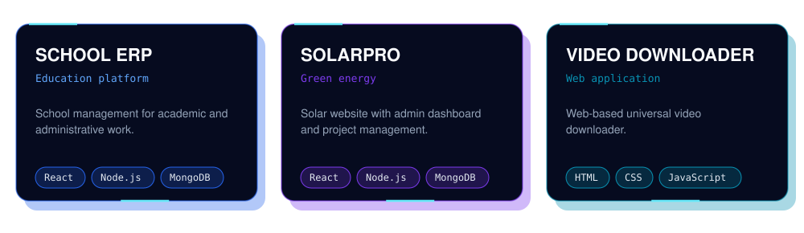

 

## Tech Stack

## Featured Projects

## GitHub Performance

## 3D Contribution World

## Contribution Snake

## Let's Connect

**Open to collaboration, learning and exciting opportunities.**

