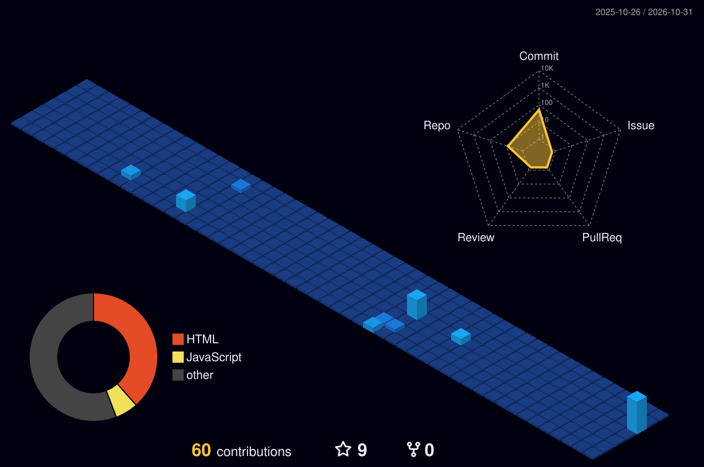
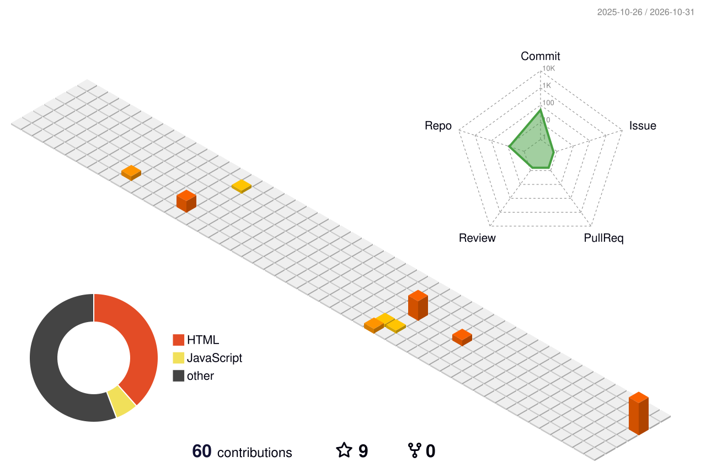
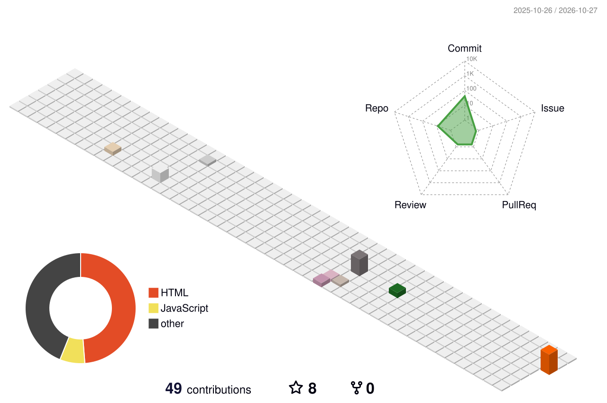

 

  

<a href="https://github.com/Raj22139">GitHub Profile</a> &nbsp; • &nbsp;
<a href="https://github.com/Raj22139?tab=repositories">My Projects</a> &nbsp; • &nbsp;
<a href="mailto:rajy9648adav@gmail.com">Contact Me</a>

---

## ◈ CONNECTING IDEAS WITH CODE ◈

<table>
<tr>
<td width="58%" valign="top">

### 👨‍💻 ABOUT ME

Hi! I'm **Yadav Raj** 👋, a Full Stack Developer passionate about building modern digital experiences.

- 🚀 Full Stack Web Development
- ⚛️ React & JavaScript
- 🔧 Node.js & Python
- 🗄️ MongoDB
- ☕ Java & Django
- 💡 Learning, creating and exploring

**My philosophy:** Build things that solve real problems.

</td>
<td width="42%" align="center">

  

 

 

</td>
</tr>
</table>

---

## ⚡ TECH STACK

<table>
<tr>
<td align="center" width="33%">

**FRONTEND**

</td>
<td align="center" width="33%">

**BACKEND**

</td>
<td align="center" width="33%">

**DATABASE & TOOLS**

</td>
</tr>
</table>

---

## 🚀 FEATURED PROJECTS

<table>
<tr>
<td width="33%" valign="top">

### 🏫 SCHOOL ERP

School management platform for simplifying academic and administrative operations.

**Stack**

`React` `Node.js` `MongoDB`

<a href="https://github.com/Raj22139?tab=repositories">Explore ↗</a>

</td>
<td width="33%" valign="top">

### ☀️ SOLARPRO

Solar energy website with an admin dashboard and project management features.

**Stack**

`React` `Node.js` `MongoDB`

<a href="https://github.com/Raj22139?tab=repositories">Explore ↗</a>

</td>
<td width="33%" valign="top">

### 📥 VIDEO DOWNLOADER

A web-based universal video downloader project.

**Stack**

`HTML` `CSS` `JavaScript`

<a href="https://github.com/Raj22139?tab=repositories">Explore ↗</a>

</td>
</tr>
</table>

---

## 📊 GITHUB PERFORMANCE

  

---

## 🧊 3D CONTRIBUTION WORLD

 

 

---

## 🐍 CONTRIBUTION SNAKE

<picture>
  <source media="(prefers-color-scheme: dark)" srcset="https://raw.githubusercontent.com/Raj22139/Raj22139/output/github-snake-dark.svg">
  <source media="(prefers-color-scheme: light)" srcset="https://raw.githubusercontent.com/Raj22139/Raj22139/output/github-snake.svg">
  
</picture>

---

## 🌐 LET'S CONNECT

  

**Open to collaboration, learning and exciting opportunities.**

### 💜 CODE • CONNECT • CREATE • INNOVATE

